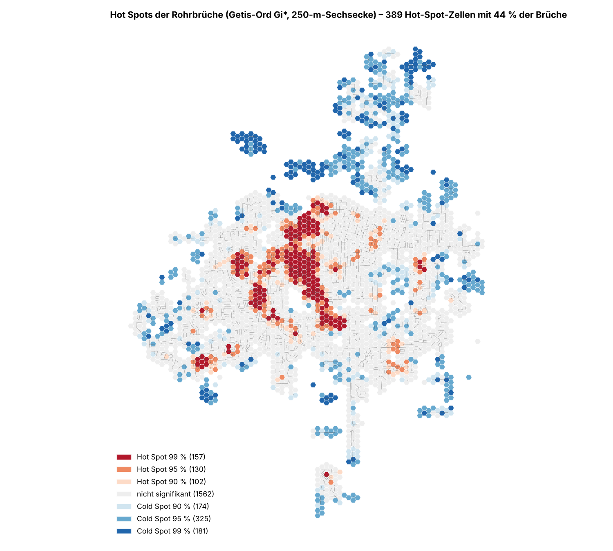
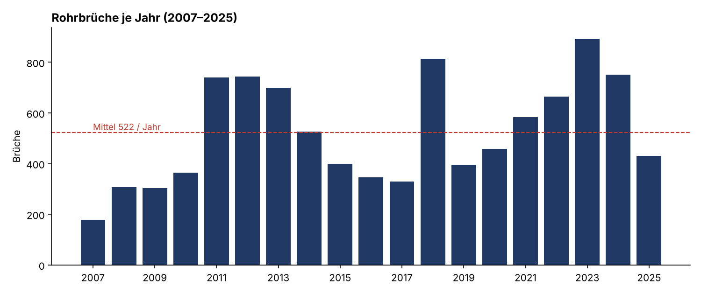
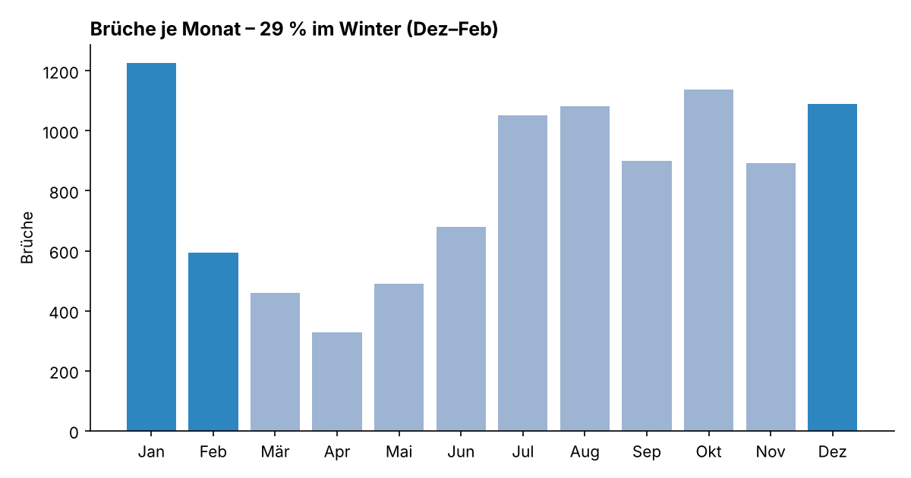
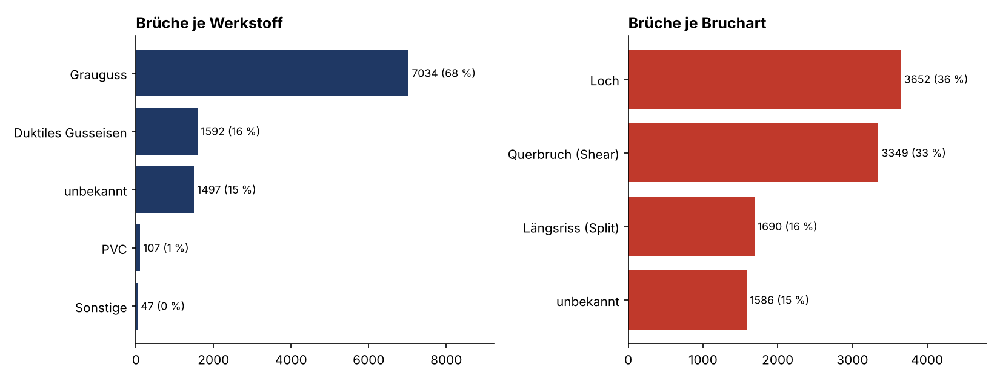
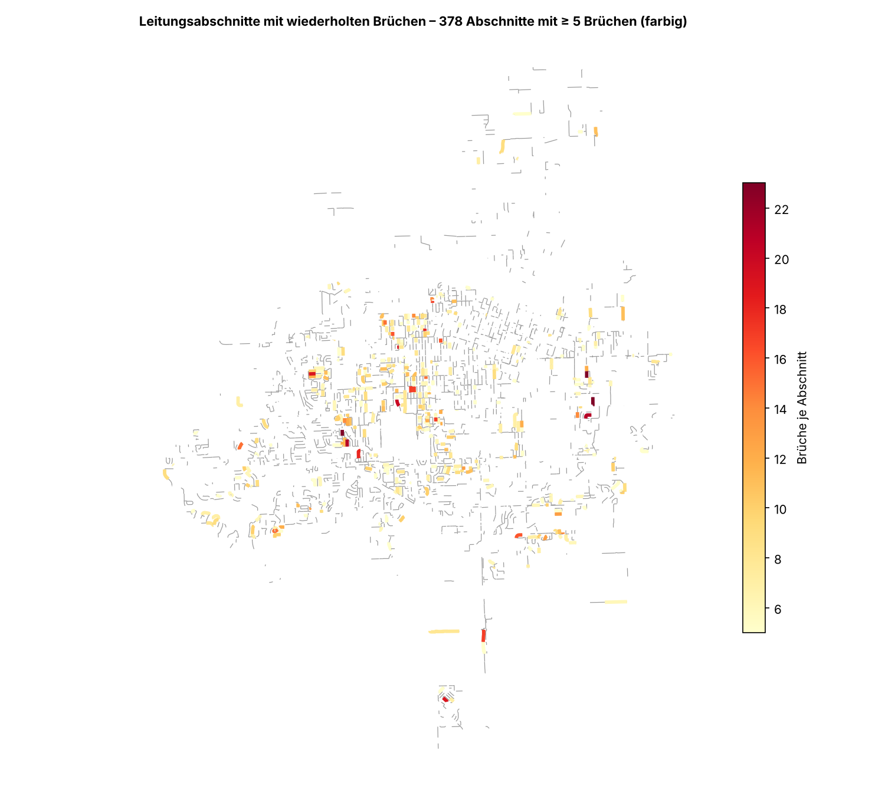

# Water Main Breaks – Topeka (Kansas)

[English](#water-main-breaks--topeka-kansas) | [Deutsch](#deutsch)

Where and why do water mains break? This project analyses **10,277 water main breaks (2007–2026)** of the **City of Topeka (Kansas)**: **breaks by material, break type, year and month**, **mains with repeated breaks** and a **hot spot analysis (Getis-Ord Gi\*)** on a 250 m hexagon grid. The result is a hot spot map, a ranking of the mains with the most breaks, Excel tables and a short **management report** – the typical break analysis of a water utility's asset management.



---

## Key results

| | |
|---|---|
| Study area | City of Topeka, Kansas (USA) |
| Main breaks | **10,277** work orders (2007–2026), on average **522 per year**; peak year **2023 (892)** |
| Material | **68.4 %** cast iron, 15.5 % ductile iron, 1.0 % PVC, 14.6 % unknown |
| Break type | hole 35.5 %, shear (circumferential) 32.6 %, split (longitudinal) 16.4 % |
| Season | peaks in **winter** (Jan, Dec) and **late summer / autumn** (Jul–Oct); 29.3 % in Dec–Feb |
| Repair costs | **54.0 million USD** in total, median **3,283 USD** per break |
| Repeated breaks | **378** main sections with ≥ 5 breaks carry **37.3 %** of all breaks |
| Hot spots | **389** hot spot cells (15 % of the cells) contain **43.6 %** of all breaks |

**Top 5 main sections (≥ 20 m)**

| # | Facility ID | Material | Diameter | Length (m) | Breaks |
|---|---|---|---|---|---|
| 1 | 22541 | unknown | 6″ | 189 | 23 |
| 2 | 5984 | cast iron | 6″ | 216 | 23 |
| 3 | 32118 | cast iron | 6″ | 270 | 23 |
| 4 | 21871 | cast iron | 4″ | 234 | 21 |
| 5 | 6561 | cast iron | 6″ | 275 | 21 |

**Interpretation:** the breaks are concentrated in space and on a small number of mains. Hot spots are in the central and western city, where old small-diameter cast-iron mains dominate. The two seasonal peaks point to frost and temperature changes in winter and to shrinking clay soils in late summer. **Recommended measures:** include the 378 sections with ≥ 5 breaks in renewal planning (cast iron in the hot spots first), investigate pressure, soil type and installation year in the hot spot cells, complete missing material and break type data and use the complete mains inventory to calculate break rates per km for the whole network.

| | |
|---|---|
|  |  |
|  |  |

---

## Workflow

1. **Data** – two public ArcGIS REST services of the City of Topeka (`Water Main Break Workorder Location`, `Water Main Break Count`) loaded in QGIS and saved as GeoPackage `topeka_water.gpkg` (layers `breaks`, `mains`), NAD83 / Kansas North (ftUS), EPSG:3419
2. **Cleaning** – cancelled work orders and points with coordinates outside the network removed (10 of 10,287); empty material and break type set to "unknown"
3. **Statistics** – breaks by material, break type, year and month; repair costs; breaks per km by material for the mains with breaks
4. **Repeated breaks** – main sections ranked by break count (sections ≥ 20 m), sections with ≥ 5 breaks
5. **Hot spots** – 250 m hexagon grid along the network, number of breaks per cell, Getis-Ord Gi\* with 6 nearest neighbours and 999 permutations, classes 90 / 95 / 99 %
6. **Results** – maps, charts, Excel and CSV tables, hot spot GeoPackage for QGIS, 2-page report in German

## Limitations

- The mains layer contains only sections with at least one break (393 km); break rates per km for the whole network need the complete mains inventory
- 14.6 % of the breaks have no material and 15.4 % no break type
- Hot spot results depend on the cell size (250 m) and the neighbourhood definition
- No data on pressure, soil or installation year are included

---

## Repository structure

```
Water-Main-Breaks-Topeka/
├── notebooks/
│   └── water_main_breaks_topeka.ipynb
├── images/
│   ├── 01_Hotspots_Topeka.png
│   ├── 02_Brueche_je_Jahr.png
│   ├── 03_Brueche_je_Monat.png
│   ├── 04_Werkstoff_Bruchart.png
│   └── 05_Wiederholte_Brueche.png
├── results/
│   ├── Rohrbruchanalyse_Topeka_Bericht.pdf    # report (German)
│   ├── water_main_breaks_topeka.xlsx          # all tables
│   ├── hotspots_topeka.gpkg                   # hot spot cells for QGIS
│   ├── kennzahlen.csv
│   ├── brueche_je_werkstoff.csv
│   ├── brueche_je_jahr.csv
│   └── top20_leitungen.csv
├── requirements.txt
├── LICENSE
└── README.md
```

The notebook runs in Google Colab; the GeoPackage exported from QGIS is uploaded at the start. Like the raw data, it is not included in this repository.

## Tools

Python · GeoPandas · PySAL (libpysal, esda) · pandas · Matplotlib · QGIS · ArcGIS REST · Google Colab

## Data sources

Water main breaks and mains with break counts: City of Topeka (Kansas), public ArcGIS REST services, retrieved November 2026. The raw data are not included in this repository.

## License

Code: MIT License – see [LICENSE](LICENSE)

---
---

# Deutsch

[English](#water-main-breaks--topeka-kansas) | [Deutsch](#deutsch)

Wo und warum brechen Wasserleitungen? Dieses Projekt analysiert **10.277 Rohrbrüche (2007–2026)** der **Stadt Topeka (Kansas)**: **Brüche nach Werkstoff, Bruchart, Jahr und Monat**, **Leitungen mit wiederholten Brüchen** und eine **Hot-Spot-Analyse (Getis-Ord Gi\*)** auf einem 250-m-Sechseckraster. Das Ergebnis sind eine Hot-Spot-Karte, eine Rangliste der Leitungen mit den meisten Brüchen, Excel-Tabellen und ein kurzer **Bericht** – die typische Schadensanalyse im Asset-Management eines Wasserversorgers.


---

## Zentrale Ergebnisse

| | |
|---|---|
| Untersuchungsgebiet | Stadt Topeka, Kansas (USA) |
| Rohrbrüche | **10.277** Arbeitsaufträge (2007–2026), im Mittel **522 pro Jahr**; Spitzenjahr **2023 (892)** |
| Werkstoff | **68,4 %** Grauguss, 15,5 % duktiles Gusseisen, 1,0 % PVC, 14,6 % unbekannt |
| Bruchart | Loch 35,5 %, Querbruch 32,6 %, Längsriss 16,4 % |
| Jahreszeit | Spitzen im **Winter** (Jan, Dez) und im **Spätsommer/Herbst** (Jul–Okt); 29,3 % von Dez–Feb |
| Reparaturkosten | **54,0 Mio. USD** gesamt, Median **3.283 USD** je Bruch |
| Wiederholte Brüche | **378** Leitungsabschnitte mit ≥ 5 Brüchen tragen **37,3 %** aller Brüche |
| Hot Spots | **389** Hot-Spot-Zellen (15 % der Zellen) enthalten **43,6 %** aller Brüche |

**Top 5 Leitungsabschnitte (≥ 20 m)**

| # | Facility-ID | Werkstoff | Nennweite | Länge (m) | Brüche |
|---|---|---|---|---|---|
| 1 | 22541 | unbekannt | 6″ | 189 | 23 |
| 2 | 5984 | Grauguss | 6″ | 216 | 23 |
| 3 | 32118 | Grauguss | 6″ | 270 | 23 |
| 4 | 21871 | Grauguss | 4″ | 234 | 21 |
| 5 | 6561 | Grauguss | 6″ | 275 | 21 |

**Interpretation:** Die Brüche konzentrieren sich räumlich und auf wenige Leitungen. Die Hot Spots liegen im zentralen und westlichen Stadtgebiet, wo alte Graugussleitungen kleiner Nennweite überwiegen. Die zwei saisonalen Spitzen deuten auf Frost und Temperaturwechsel im Winter und auf schrumpfende Tonböden im Spätsommer hin. **Maßnahmen:** die 378 Abschnitte mit ≥ 5 Brüchen in die Erneuerungsplanung aufnehmen (zuerst Grauguss in den Hot Spots), in den Hot-Spot-Zellen Druck, Bodenart und Baujahr untersuchen, fehlende Angaben zu Werkstoff und Bruchart ergänzen und für Bruchraten je km im gesamten Netz den vollständigen Leitungsbestand verwenden.

---

## Arbeitsablauf

1. **Daten** – zwei öffentliche ArcGIS-REST-Dienste der Stadt Topeka (`Water Main Break Workorder Location`, `Water Main Break Count`) in QGIS geladen und als GeoPackage `topeka_water.gpkg` gespeichert (Layer `breaks`, `mains`), NAD83 / Kansas North (ftUS), EPSG:3419
2. **Bereinigung** – stornierte Aufträge und Punkte mit Koordinaten außerhalb des Netzes entfernt (10 von 10.287); leerer Werkstoff und leere Bruchart als „unbekannt“
3. **Statistik** – Brüche nach Werkstoff, Bruchart, Jahr und Monat; Reparaturkosten; Brüche je km nach Werkstoff für die Leitungen mit Brüchen
4. **Wiederholte Brüche** – Leitungsabschnitte nach Anzahl der Brüche sortiert (Abschnitte ≥ 20 m), Abschnitte mit ≥ 5 Brüchen
5. **Hot Spots** – 250-m-Sechseckraster entlang des Netzes, Anzahl der Brüche je Zelle, Getis-Ord Gi\* mit 6 nächsten Nachbarn und 999 Permutationen, Klassen 90 / 95 / 99 %
6. **Ergebnisse** – Karten, Diagramme, Excel- und CSV-Tabellen, Hot-Spot-GeoPackage für QGIS, Bericht mit 2 Seiten

## Einschränkungen

- Der Leitungslayer enthält nur Abschnitte mit mindestens einem Bruch (393 km); Bruchraten je km für das gesamte Netz brauchen den vollständigen Leitungsbestand
- 14,6 % der Brüche haben keinen Werkstoff und 15,4 % keine Bruchart
- Die Hot-Spot-Ergebnisse hängen von der Zellgröße (250 m) und der Nachbarschaftsdefinition ab
- Keine Daten zu Druck, Boden oder Baujahr enthalten

---

## Werkzeuge

Python · GeoPandas · PySAL (libpysal, esda) · pandas · Matplotlib · QGIS · ArcGIS REST · Google Colab

## Datenquellen

Rohrbrüche und Leitungen mit Bruchanzahl: City of Topeka (Kansas), öffentliche ArcGIS-REST-Dienste, abgerufen im November 2026. Die Rohdaten sind nicht in diesem Repository enthalten.

## Lizenz

Code: MIT-Lizenz – siehe [LICENSE](LICENSE)
